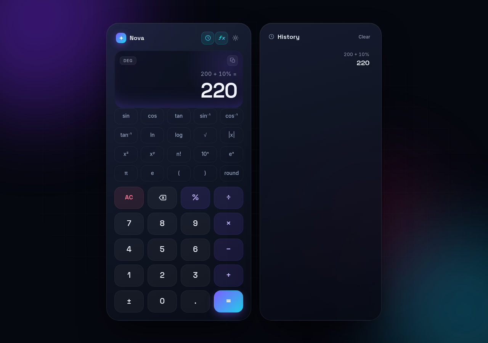

# Nova · Calculator

A polished, glassmorphic calculator web app built with plain HTML, CSS, and JavaScript. No build step, no runtime dependencies.



## Run it

Open `index.html` in a browser, or use the bundled zero-dependency server:

```bash
npm start
# then visit http://localhost:8080
```

Any static file server works too (`python3 -m http.server 8080`). A server is required for the installable PWA build and offline mode.

## Features

- **Live preview** — the result updates as you type, with a separate expression line
- **Correct precedence** — `2 + 3 × 4` is `14`; supports parentheses, powers, and implicit multiplication (`2π`, `2(3+4)`)
- **Contextual percent** — `200+10%` is `220`, `200-10%` is `180`, `100×10%` is `10`
- **Scientific notation** — `1e3` is `1000`, `1.5e-2` is `0.015`
- **Scientific mode** — `sin`, `cos`, `tan`, `sin⁻¹`, `cos⁻¹`, `tan⁻¹`, `ln`, `log`, `√`, `|x|`, `x²`, `xʸ`, `n!`, `10ˣ`, `eˣ`, `round`, `π`, `e`
- **DEG / RAD** angle toggle, with inverse trig returning the active unit
- **History** — last 40 calculations, click any entry to reuse its result; saved in `localStorage`
- **Copy** — one click, or `Ctrl`/`Cmd` + `C`, copies the current result
- **Dark & light themes** — follows your system preference by default
- **Installable PWA** — offline capable, with an app icon and no app store
- **Full keyboard support**, including single-key function shortcuts
- **Responsive** — history becomes a slide-out drawer on small screens
- **Accessible** — focus states, ARIA labels, polite announcements, reduced-motion support

## Keyboard shortcuts

| Key | Action |
| --- | --- |
| `0–9`, `.` | Numbers |
| `+` `-` `*` `/` `^` | Operators |
| `%` | Percent (contextual) |
| `!` | Factorial |
| `(` `)` | Parentheses |
| `Enter` or `=` | Evaluate |
| `Backspace` | Delete last input |
| `Esc` or `Delete` | Clear |
| `Ctrl`/`Cmd` + `C` | Copy the result |
| `s` `c` `t` | `sin(` `cos(` `tan(` |
| `l` `g` `r` `a` | `ln(` `log(` `√(` `abs(` |
| `e` `p` | Euler's number, π |

## Notes

- `%` is contextual when it follows a value: `200+10%` is 220. On its own, `50%` is `0.5`.
- `e` is Euler's number unless it is followed by digits, in which case the digits are read as an exponent (`2e3` is 2000, `2×e` is 5.4366).
- Functions accept brackets or a bare argument: `sin(30)` and `sin30` are the same.
- The live preview and the final answer always agree — open brackets are closed automatically.
- The display rounds to 12 significant digits to keep floating-point noise out of results.
- Calculations are stored locally only; nothing leaves your browser.

## Development

```bash
npm test      # engine test suite (Node's built-in runner, no dependencies)
npm start     # static server on http://localhost:8080
npm run icons # regenerate the PNG app icons from icons/icon.svg
```

Tests live in `test/engine.test.js` and run in CI on every push and pull request.

## Deploying

The app is a static site. The included GitHub Actions workflow publishes it to GitHub Pages — enable **Settings → Pages → Source: GitHub Actions** in the repository, and the site appears at `https://hopeIsCo0l.github.io/novac/`.

## Files

```
novac/
├── index.html            # markup
├── styles.css            # theme tokens, layout, animations
├── engine.js             # tokenizer, parser, formatting (DOM-free, Node-testable)
├── app.js                # UI state, input handling, history, events
├── sw.js                 # service worker (offline app shell)
├── manifest.webmanifest  # PWA manifest
├── icons/                # app icons
├── test/engine.test.js   # engine test suite
└── tools/                # dev server and icon generator
```

## License

MIT © 2026 hopeIsCo0l
